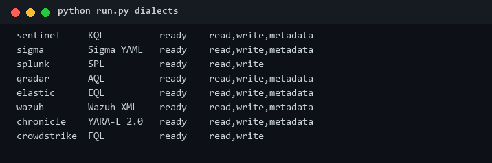

# RuleForge

**A local detection-rule workbench for SIEM, EDR and cloud query languages.**

Author a rule once, read it in eight dialects, test it against real log samples,
and keep the history of how it changed.

---

## Contents

- [Why this exists](#why-this-exists)
- [Features](#features)
- [Quick start](#quick-start)
- [The workbench](#the-workbench)
- [Command line](#command-line)
- [Supported dialects](#supported-dialects)
- [Three verdicts](#three-verdicts)
- [Refusals](#refusals)
- [Design principles](#design-principles)
- [Project structure](#project-structure)
- [Testing](#testing)
- [Known limitations](#known-limitations)
- [Scope and security](#scope-and-security)
- [Requirements](#requirements)
- [Contributing](#contributing)
- [License](#license)

---

## Why this exists

Every design decision in RuleForge comes from a single failure mode:

> **A rule that matches more than its author intended, while reporting success.**

That is worse than a crash. A crash is loud, gets investigated, and gets fixed.
A rule that silently widened from *"five failed logons from one account"* to
*"any failed logon"* returns a green check mark and gets deployed — and nobody
investigates a green result.

RuleForge is built to make that outcome impossible. It does not approximate the
hard parts of a conversion. When a rule cannot cross a dialect boundary without
changing meaning, it refuses by name, states what would have gone wrong, and
exits non-zero.

It is a **workbench**, not a SIEM and not a deployment tool. It parses untrusted
rule text, evaluates rules against untrusted samples, and never claims to know
your data volume.

---

## Features

| | |
|---|---|
| **Read a rule you did not write** | Paste a Sigma rule, a Splunk search, a KQL query, Wazuh XML, AQL, EQL, YARA-L or an FQL filter. It comes back as a structured rule with an outline that says, in prose, what the thing actually matches — including the parts that do not mean what they look like. |
| **Convert between dialects** | Any supported dialect to any other. What *cannot* cross is reported rather than dropped. |
| **Test against samples** | Paste events and get `matched`, `no_match` or `not_evaluated`, with a stage-by-stage trace of where rows were lost. |
| **Propose a rule from logs** | Paste several samples of the same behaviour and it reports which fields are stable enough to be a detection, and which only looked stable. The output is labelled a hypothesis, because it is one. |
| **Keep the history** | Every saved rule records its origin — `authored`, `imported` or `synthesized` — and its parent, so a rule's lineage stays readable. |
| **Run headless** | The same engine from a shell, with refusals on stderr and the answer in the exit code. A detection engineer cannot put a browser in CI. |

---

## Quick start

```bash
git clone https://github.com/EclipseManic/RuleForge.git
cd RuleForge
python run.py
```

```
  RuleForge -- Detection Rule Workbench
  http://127.0.0.1:8765/

  Eight dialects, one rule model, standard library only.
  Ctrl+C to stop.
```

There is **no install step, no build step and no configuration.** `run.py` is
the only entry point; it puts the repository on `sys.path` itself.

Verify the checkout before you trust it:

```bash
python run.py verify
```

Output from a real run on this machine, `python run.py dialects`:



That runs the full test suite and then sweeps 403 real-shaped rules through all
eight dialects.

---

## The workbench

`python run.py` serves a single-page interface from the Python standard library
at `http://127.0.0.1:8765/`, in two sections:

**Home** — where you left off, recent history, and quick actions.

**Studio** — the working surface, in six panes:

| Pane | Purpose |
|---|---|
| **Workbench** | Build and edit a rule against the vendor-neutral model, with live rendering into a target dialect |
| **Import & Explain** | Paste a rule in any supported language and read back a plain-language outline of what it matches |
| **From Log** | Derive a candidate rule from log samples, with each field marked stable or volatile |
| **Datasets** | Saved, hashed event samples used as replay evidence |
| **Test Runs** | Immutable records of a rule version run against a dataset, with verdict and stage trace |
| **History** | Every saved version, its origin, and its lineage |

Options:

```bash
python run.py serve --port 9000     # try a different port
python run.py serve --no-browser    # do not open a browser
python run.py serve --host 127.0.0.1
```

If the preferred port is busy, `run.py` moves to the next free one and tells you
which port it actually bound — it never prints a URL it is not serving.

---

## Command line

`run.py` serves the workbench, runs the repository's own checks, and passes
everything else straight through to the engine CLI. There is one parser to
learn, not two that can disagree.

```bash
python run.py dialects                            # list the eight dialects
python run.py check     sigma    rule.yml         # parse, validate, report losses
python run.py explain   sigma    rule.yml         # say what the rule matches
python run.py convert   sigma sentinel rule.yml   # translate
python run.py test      sigma    rule.yml events.jsonl
python run.py propose   samples.jsonl --target sigma
```

`-` reads from stdin, so the subcommands compose:

```bash
python run.py convert sigma splunk rule.yml | python run.py check splunk -
```

### Exit codes

| Code | Meaning |
|---|---|
| `0` | The work succeeded |
| `1` | A rule was refused, or a conversion lost something |
| `2` | The arguments were wrong |

A **lossy conversion exits `1` even though it printed the text**, so a pipeline
cannot deploy a widened rule without noticing.

---

## Supported dialects

| Key | Vendor | Language | Reads | Writes | Carries metadata |
|---|---|:---:|:---:|:---:|---|
| `sentinel` | Microsoft Sentinel | KQL | yes | yes | as a `//` header |
| `sigma` | Sigma | YAML | yes | yes | natively |
| `splunk` | Splunk | SPL | yes | yes | no — see below |
| `qradar` | IBM QRadar | AQL | yes | yes | as a `--` header |
| `elastic` | Elastic Security | EQL | yes | yes | as a `//` header |
| `wazuh` | Wazuh | XML | yes | yes | `<description>` |
| `chronicle` | Google SecOps | YARA-L 2.0 | yes | yes | `meta:` |
| `crowdstrike` | CrowdStrike Falcon | FQL | yes | yes | no — see below |

SPL and FQL cannot carry a rule's triage header: Splunk keeps that in a
`savedsearches.conf` stanza, and an FQL filter is a single string with no comment
syntax. Rendering into either reports `ANNOTATIONS_NOT_TRANSFERABLE` rather than
losing the title and severity quietly.

---

## Three verdicts

```
matched        rows survived the pipeline
no_match       nothing survived, and the engine is confident
not_evaluated  nothing survived, and the engine cannot be confident
```

`not_evaluated` is the whole point. A rule testing a field your sample does not
contain has not failed to match — the question was never answered, and saying
`no_match` would be a lie an analyst would act on.

An unapplied index-time filter is the one caveat that does *not* block a
confident negative, because removing rows cannot create a match — unless the rule
contains an anti-join, which asks for rows with no counterpart. Those keep the
strict verdict.

---

## Refusals

A refusal is a feature. Each one carries a code, the stage it came from, and a
sentence saying what would have gone wrong:

```
SEQUENCE_NO_JOIN_KEY    this sequence has nothing to join the steps on, so any
                        first event would pair with any later one anywhere in
                        the estate

WAZUH_RENDER_NO_SORT    Wazuh has no ordering. A rule whose meaning depends on
                        order has no Wazuh form, and writing it without the
                        ordering returns a different event

SPL_GENERATING_TSTATS   `tstats` reads an accelerated summary, not events, so
                        there is nothing for a sample to be tested against.
                        Rewrite it as a `search` over an index
```

The list is long on purpose. A tool that accepts everything and quietly
approximates the hard parts is a tool that produces rules nobody can trust.

---

## Design principles

**Every dispatch chain ends in a refusal.** Not a silent `else`, not a `pass`,
not a `continue`. If a renderer meets a stage it cannot express, it says so by
name. This is enforced by `tests/test_fidelity.py`, which sweeps a corpus of
rules through every dialect pair and fails if any field name or literal value
disappears without a diagnostic. That test exists because two renderers were
cherry-picking stages out of the pipeline and dropping the rest — including
thresholds.

**Absent, null, empty and undecided are four different things.** A missing field
is not an empty one. Sigma's `field: null` asks whether a field is present and
null; KQL's `isnull()` has no such distinction because its schema is fixed. They
lower to different predicates, deliberately.

**Numbers are `Decimal` end to end.** A float threshold that compares unequal to
itself is not a threshold.

**A regex is only executed when the flavour can be honoured.** PCRE, PCRE2,
OS-Regex and Java regex are refused rather than run through Python's `re` and
reported as though they were the real thing. RE2 and POSIX ERE do execute,
because on the portable subset they agree. Every pattern is screened for
catastrophic backtracking first.

**Nothing above the engine knows a vendor's syntax**, and nothing in the engine
knows a vendor exists. That is what makes eight dialects possible without eight
tools, and it is enforced by a test rather than by good intentions.

---

## Project structure

```
RuleForge/
├── run.py                  the single entry point
├── engine/                 the vendor-neutral engine
│   ├── cli.py              headless subcommands and the exit-code contract
│   ├── ir.py               the rule model: 11 expression nodes, 13 stage nodes
│   ├── values.py           ABSENT, UNDECIDED, Refusal, Duration, Capability
│   ├── evaluate.py         three-valued expression evaluation, regex screening
│   ├── pipeline.py         pipeline execution, verdicts, the stage trace
│   ├── validate.py         structural lint and the ReDoS screen
│   ├── codec.py            lossless tagged-JSON serialisation of a rule
│   ├── store.py            append-only SQLite history with lineage
│   ├── synthesize.py       log samples to a proposed rule
│   └── dialects/           shared parser plus eight vendor languages
│       ├── common.py       tokenizer and Pratt parser; a bug here is a bug
│       │                   in all eight dialects at once
│       ├── sigma.py  kql.py  splunk.py  qradar.py
│       └── elastic.py  wazuh.py  chronicle.py  crowdstrike.py
├── web/                    the browser half
│   ├── api.py              stdlib http.server: routing, limits, hardening
│   ├── templates/          the Home + Studio interface
│   └── static/             app.css, app.js
├── tests/                  1345 tests, standard-library unittest
├── corpus/                 403 real-shaped rules swept across every dialect pair
├── examples/               a rule pack with positive and negative fixtures
├── data/                   runtime only: saved rule history, never in git
├── pyproject.toml          packaging metadata
└── README.md
```

---

## Testing

```bash
python run.py verify
```

That runs the suite and then the corpus sweep. The suite alone is:

```bash
python -m unittest discover -s tests -t .
```

`pytest` also works, but it is not the floor: a check that needs a dependency
cannot run in the locked-down SOC this tool is built for.

Three test modules are worth knowing about:

**`tests/test_fidelity.py`** is a **sweep, not a set of cases.** It walks a corpus
of rules through every dialect pair and asserts general properties: that no field
name or literal value disappears without a diagnostic, and that every renderer
emits text its own parser accepts. It exists because the suite was fully green
while a renderer silently dropped thresholds — every test checked a conversion
somebody had thought to check. A case tests what its author remembered; a sweep
tests what nobody thought of. The second property, re-reading the output, found
eight more defects the first one could not see, including a renderer emitting
`count(1)` that the same module's parser rejects.

**`tests/test_cli.py`** holds the BOM tests. A UTF-8 BOM silently renamed the
first key of a rule, so a Sigma file saved by a Windows editor reported "this rule
has no title" about a rule whose first line was the title. It was found because
the CLI's own fixture was written with PowerShell, which adds one.

**`tests/__init__.py`** holds `planned_dialect`, a synthetic registry entry. All
eight dialects ship, so the planned-dialect refusal paths have no real dialect to
point at — and pinning them to one that later shipped inverted them twice,
silently, in this repository's history.

---

## Known limitations

Stated because a tool that hides these is worse than one that does not have them:

- **The sweeps are bounded by their corpus.** This is the honest limit, not a
  disclaimer: it is the mechanism by which two separate silent-widening bugs
  survived earlier rounds of "it's complete". A rule shape not in
  `tests/test_fidelity.py` is unexamined.

- **An ABSENT field makes a comparison UNDECIDED, not False.** This is a
  deliberate open-world choice, and it has a cost worth knowing before you trust
  a verdict: `selection and not filter` — the commonest idiom in SigmaHQ —
  reports `not_evaluated` rather than matching when the filter's field is missing
  from the sample event, because `NOT UNDECIDED` is `UNDECIDED`. The real SIEM,
  compiling that rule against a fixed schema, would fire. So a sample event must
  carry the fields a rule's filters mention for the verdict to be decided. The
  engine says `not_evaluated` and names the absent field rather than reporting a
  confident non-match, which is the tradeoff being made: a loud "I don't know"
  instead of a quiet wrong answer. `RealRulesMatchTheRightEvents` pins it so it
  cannot change silently.

- **The browser code has no behavioural tests.** Logic has been moved out of it
  where possible — synthesis, log parsing — but the form-to-IR binding and all
  rendering are unverified by the suite.

- **Every dialect covers a subset of its language.** The refusals are honest, but
  `tstats`, `sample`, `eventstats`, multi-event YARA-L and a long list more are
  refused rather than supported. Known gaps found by running real vendor rules:
  Sigma's bare `keywords:` full-text search, multi-document Sigma (so
  `correlation` rules must be lowered one document at a time), SPL subsearches
  (`[ search ... ]`), and computed AQL `SELECT` expressions such as
  `LOGSOURCENAME(logsourceid) AS "Log Source"`. All four refuse by name rather
  than misreading.

- **PCRE, PCRE2 and Java regex are modelled and rendered but never executed**, so
  a Sigma `|re` carrying PCRE or an AQL `MATCHES` is reported `not_evaluated`
  rather than guessed at. Wazuh OS-Regex and POSIX BRE are refused for a
  different reason — specific characters mean different things there — so a
  pattern containing none of those characters is executed exactly, which is what
  makes an ordinary Wazuh `<field>` rule locally testable.

- **SPL and FQL cannot carry a rule's triage header**, and say so.

---

## Scope and security

RuleForge is a workbench, not a service.

- It binds to `127.0.0.1` by default and prints a warning if you point it
  anywhere routable.
- It does not ship rules to a SIEM, and it has no deployment connector.
- It does not pretend to know your data volume: a threshold it proposes is a
  number it chose, and it says so.
- It reads and writes only local files, and stores history in a local SQLite
  database under `data/`.

---

## Requirements

- **Python 3.10 or newer.** The floor is real: the model uses `slots=True`
  dataclasses, which 3.9 does not accept.
- **Nothing else.** The engine, every dialect, the HTTP server and the entire
  test suite import only the standard library. There is no PyYAML, no Flask, no
  pytest requirement — the YAML reader, the HTTP server and the test harness are
  all written against the stdlib.

That constraint is deliberate. It is what lets RuleForge run unmodified inside a
locked-down SOC where `pip install` is not available.

---

## Contributing

```bash
git clone https://github.com/EclipseManic/RuleForge.git
cd RuleForge
python run.py verify          # must be green before and after your change
```

Guidelines:

- **Keep the dependency count at zero.** Adding one is an architectural
  decision, not a convenience.
- **Every new dialect feature needs a refusal for what it cannot express.** A
  silently dropped stage is a bug, even when the output looks right.
- **Add a corpus rule** for any vendor syntax you start supporting, so the
  fidelity sweep covers it.
- **Never weaken a test to get a green run.** If a test looks wrong, say so in
  the pull request.

Issues and pull requests are welcome.

---

## License

No license has been chosen for this project yet. Under the default, that means
all rights are reserved. If you want to use, modify or redistribute RuleForge,
please open an issue to discuss licensing first.

